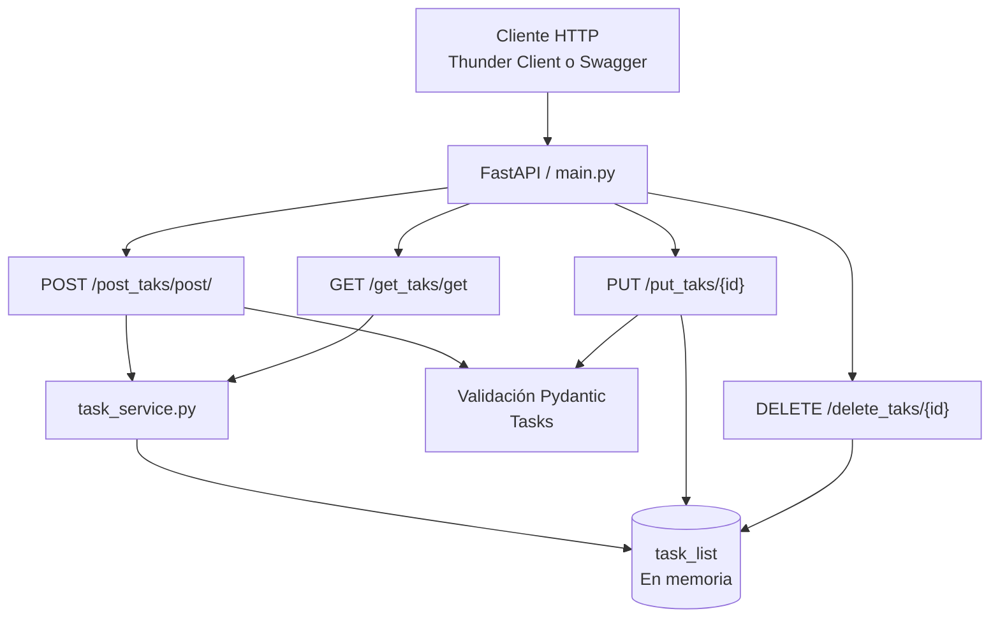

✅ TaskFlow API
API REST de gestión de tareas desarrollada con Python y FastAPI
Una aplicación backend de aprendizaje que permite crear, consultar, actualizar y eliminar tareas mediante operaciones CRUD, con validación de datos y una estructura modular.

Explorar endpoints · Instalación · Arquitectura · Próximas mejoras

📌 Acerca del proyecto
TaskFlow API es un proyecto práctico de desarrollo backend creado para comprender el ciclo de una petición HTTP, la construcción de endpoints con FastAPI y la separación de responsabilidades entre archivos.

Actualmente, las tareas se almacenan en una lista de Python en memoria, por lo que no existe una base de datos ni persistencia de información. Los datos se pierden cuando el proceso que mantiene la lista se reinicia.
Funcionalidades implementadas
- ✅ POST: crear una tarea a partir de un JSON validado.
- ✅ GET: consultar todas las tareas almacenadas.
- ✅ PUT: actualizar una tarea existente mediante su identificador.
- ✅ DELETE: eliminar una tarea mediante su identificador.
- ✅ Validación: definir la estructura de los datos con Pydantic.
- ✅ Documentación interactiva: explorar y ejecutar solicitudes desde Swagger UI (/docs).
Alcance actual: API educativa con almacenamiento temporal. No incluye autenticación, interfaz web, base de datos ni despliegue público.

🧰 Tecnologías y herramientas
Tecnología	Uso
Python	Lenguaje principal del backend.
FastAPI	Framework para crear los endpoints HTTP.
Pydantic	Validación de los datos mediante BaseModel.
Uvicorn	Servidor ASGI para ejecutar la aplicación.
Thunder Client / Swagger UI	Pruebas manuales de los endpoints.
Git y GitHub	Control de versiones y alojamiento del código.
Mermaid	Documentación visual del funcionamiento de la API.

🗂️ Estructura del proyecto
TaskFlow_API/
├── main.py                    # Aplicación FastAPI y registro de routers
├── models/
│   └── task.py                # Modelo Pydantic Tasks
├── routers/
│   ├── POST.py                # Creación de tareas
│   ├── GET.py                 # Consulta de tareas
│   ├── PUT.py                 # Actualización de tareas
│   └── DELETE.py              # Eliminación de tareas
├── services/
│   └── task_service.py        # Funciones de servicio y lista compartida
├── docs/                      # Diagramas y documentación (si se incluyen)
├── README.md
└── project-charter.md         # Documento de planificación (si se conserva)
Responsabilidades: main.py registra los routers; routers/ recibe solicitudes y construye respuestas; models/task.py define los datos requeridos; services/task_service.py concentra las funciones compartidas y el almacenamiento en memoria. Algunas operaciones pueden continuar en sus routers durante la refactorización.
🏗️ Arquitectura

Flujo de una solicitud POST: el cliente envía un JSON → FastAPI identifica la ruta → Pydantic valida el cuerpo → el router llama al servicio → el servicio guarda la tarea → el router devuelve una respuesta 201 Created.
Los diagramas describen la arquitectura que trabajamos durante el proyecto. Si cambias las funciones de services/, actualiza también este esquema.

📦 Modelo de datos
El recurso principal de la API es una tarea, definida en models/task.py:
from pydantic import BaseModel

class Tasks(BaseModel):
    id: int
    title: str
    description: str
    completed: bool
Campo	Tipo	Descripción
id	int	Identificador de la tarea.
title	str	Título de la tarea.
description	str	Descripción de la actividad.
completed	bool	Estado: true o false.

En la implementación actual, el cliente envía el ID al crear la tarea.
🚀 Instalación y ejecución
Requisitos
- Python instalado y disponible en la terminal.
- Git (opcional, para clonar el repositorio).
- VS Code u otro editor de código.
1. Clonar el repositorio
git clone https://github.com/jayemcode07-lang/TaskFlow-API.git
cd TaskFlow-API
2. Crear el entorno virtual
Windows (PowerShell o Git Bash):
python -m venv .venv
Activarlo en PowerShell:
.\.venv\Scripts\Activate.ps1
Activarlo en Git Bash:
source .venv/Scripts/activate
3. Instalar dependencias
Si el repositorio incluye requirements.txt:
python -m pip install -r requirements.txt
Si todavía no se creó ese archivo, instala las dependencias principales:
python -m pip install fastapi uvicorn
4. Iniciar la API
Desde la carpeta raíz del proyecto:
uvicorn main:app --reload
La API quedará disponible, normalmente, en:
- Servidor local: http://127.0.0.1:8000
- Swagger UI: http://127.0.0.1:8000/docs
- Esquema OpenAPI: http://127.0.0.1:8000/openapi.json
--reload reinicia el proceso de desarrollo al detectar cambios en el código. No se recomienda utilizarlo en producción.
🌐 Endpoints
Las rutas conservan el nombre taks porque así fueron definidas en el proyecto original.

Método	Endpoint	Descripción	Respuesta de éxito
POST	/post_taks/post/	Crear una tarea.	201 Created
GET	/get_taks/get	Listar todas las tareas.	200 OK
PUT	/put_taks/{id}	Actualizar una tarea existente.	200 OK
DELETE	/delete_taks/{id}	Eliminar una tarea existente.	200 OK

1. Crear tarea — POST
Solicitud
POST http://127.0.0.1:8000/post_taks/post/
Content-Type: application/json
{
  "id": 1,
  "title": "Estudiar Python",
  "description": "Practicar funciones y listas",
  "completed": false
}
Ejemplo de respuesta (201)
{
  "mensaje": "Task Successfully added",
  "task": {
    "id": 1,
    "title": "Estudiar Python",
    "description": "Practicar funciones y listas",
    "completed": false
  }
}
Enviar mensaje y task dentro de la solicitud no es necesario: esos campos forman parte de la respuesta que construye el router.

2. Consultar tareas — GET
GET http://127.0.0.1:8000/get_taks/get
Ejemplo de respuesta (200)
[
  {
    "id": 1,
    "title": "Estudiar Python",
    "description": "Practicar funciones y listas",
    "completed": false
  }
]
Si no se han creado tareas, la lista se devuelve vacía: [].
3. Actualizar tarea — PUT
PUT http://127.0.0.1:8000/put_taks/1
Content-Type: application/json
{
  "id": 1,
  "title": "Dominar FastAPI",
  "description": "Completar el CRUD y documentar la API",
  "completed": true
}
El endpoint busca la tarea por el ID de la URL y reemplaza sus datos. Si no encuentra la tarea, responde con 404 Not Found. El formato exacto del mensaje de éxito depende de la versión de PUT.py.
4. Eliminar tarea — DELETE
DELETE http://127.0.0.1:8000/delete_taks/1
Ejemplo de respuesta (200)
{
  "message": "Tarea eliminada"
}
Si el ID no existe, responde con 404 Not Found.
🧪 Cómo probar la API
1. Inicia el servidor con uvicorn main:app --reload.
2. Abre Swagger UI en /docs o Thunder Client en VS Code.
3. Envía un POST con una tarea válida.
4. Ejecuta GET para comprobar que aparece en la lista.
5. Envía PUT con el ID de esa tarea para actualizarla.
6. Consulta nuevamente con GET.
7. Ejecuta DELETE con el ID y verifica que ya no aparece.
Códigos de respuesta útiles
Código	Significado
200	Operación completada correctamente.
201	Recurso creado correctamente.
404	Ruta o tarea solicitada no encontrada, según el endpoint.
405	Método HTTP no permitido para esa ruta.
422	Datos de entrada inválidos para el esquema esperado.

Lección del desarrollo: si Thunder Client devuelve 405 al intentar crear una tarea, comprueba que hayas seleccionado POST y no GET.
📐 Diagramas y documentación
El proyecto utiliza Mermaid para representar la arquitectura y el flujo de las peticiones.

Si los has guardado en docs/, puedes enlazarlos desde aquí:
- [Diagrama general](docs/diagrama_general.md)
- [Documento de planificación](project-charter.md)
Si tus archivos están en otra ubicación o tienen nombres diferentes, actualiza estos enlaces para que funcionen en GitHub.

⚠️ Limitaciones actuales
- Sin base de datos: task_list existe únicamente en memoria.
- Sin persistencia: reiniciar el servidor borra las tareas guardadas.
- IDs enviados por el cliente: la versión actual no genera automáticamente los identificadores.
- Sin autenticación: no hay usuarios, permisos ni sesiones.
- Validaciones básicas: el modelo verifica los tipos y campos requeridos; reglas adicionales, como impedir IDs duplicados, pueden incorporarse después.
Estas limitaciones son decisiones de alcance del proyecto de aprendizaje, no características de una aplicación lista para producción.
🛣️ Próximas mejoras
- [ ] Incorporar SQLite para guardar las tareas de forma persistente.
- [ ] Separar el acceso a los datos en una capa de repositorio.
- [ ] Evitar identificadores duplicados y generar IDs automáticamente.
- [ ] Separar esquemas de creación, actualización y respuesta.
- [ ] Agregar pruebas automatizadas con pytest.
- [ ] Mejorar las respuestas y el manejo de errores.
- [ ] Explorar autenticación y despliegue en etapas posteriores.
🎯 Aprendizajes del proyecto
TaskFlow API permitió practicar:
- Desarrollo de endpoints REST con FastAPI.
- Validación de datos mediante Pydantic.
- Operaciones CRUD y códigos de estado HTTP.
- Listas, funciones, for, enumerate() y del en Python.
- Importaciones y organización de módulos.
- Separación entre routers, services y models.
- Pruebas manuales con Thunder Client y Swagger UI.
- Control de versiones, documentación y diagramas con Git, GitHub y Mermaid.

TaskFlow API · Proyecto práctico de aprendizaje backend

Hecho con Python y FastAPI, con el objetivo de comprender el código, no solo ejecutarlo.

⬆ Volver al inicio

